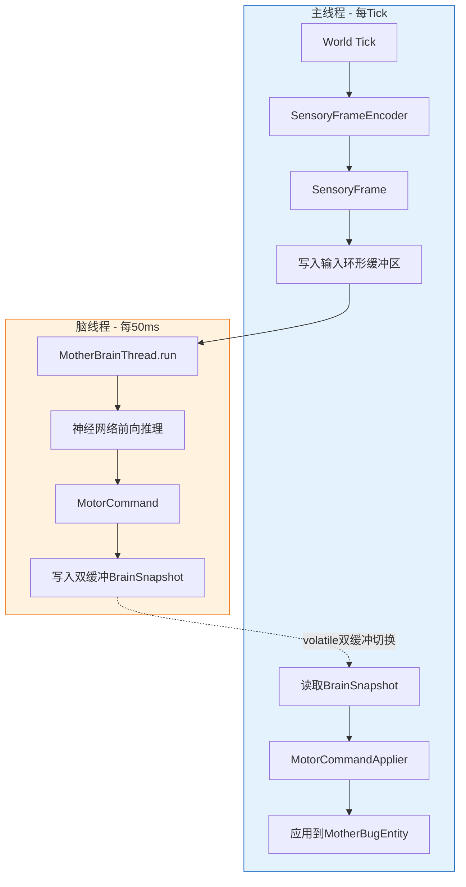

# 虫巢计划 - 架构设计文档

> 版本：1.0.0  
> 适用阶段：第一阶段 - 搭神经管道，造会动的母虫  
> 参考实现：blendi-remade/fly-brain-minecraft

---

## 1. 总体架构图



**ASCII 版本（便于终端查看）：**

```
┌─────────────────────────────────────────────────────────────────┐
│                    主线程 (Main Thread) - 每 Tick                │
│  ┌──────────┐   ┌────────────────┐   ┌──────────────┐           │
│  │ World    │──▶│ SensoryFrame   │──▶│ 输入环形缓冲区  │           │
│  │ Tick     │   │ Encoder        │   │ (lock-free)  │           │
│  └──────────┘   └────────────────┘   └──────┬───────┘           │
│                                              │                   │
│  ┌────────────────┐   ┌──────────────┐      │                   │
│  │ MotorCommand   │◀──│ BrainSnapshot │◀────┘                   │
│  │ Applier        │   │ (volatile双缓冲)  │                       │
│  └───────┬────────┘   └──────────────┘                           │
│          │                                                        │
│          ▼                                                        │
│  ┌────────────────┐                                              │
│  │ MotherBugEntity│  (应用运动指令)                               │
│  └────────────────┘                                              │
└─────────────────────────────────────────────────────────────────┘
                              ▲
                              │ 每 50ms 唤醒
                              │
┌─────────────────────────────────────────────────────────────────┐
│                    脑线程 (Brain Thread) - 固定频率              │
│  ┌──────────────┐   ┌────────────────┐   ┌──────────────────┐  │
│  │ 读取输入缓冲  │──▶│ 神经网络前向推理 │──▶│ 产出 MotorCommand │  │
│  └──────────────┘   └────────────────┘   └────────┬─────────┘  │
│                                                    │             │
│                                          ┌─────────▼─────────┐  │
│                                          │ 写入BrainSnapshot │  │
│                                          │ (双缓冲原子切换)   │  │
│                                          └───────────────────┘  │
└─────────────────────────────────────────────────────────────────┘
```

---

## 2. 五层职责说明

| 层级 | 名称 | 职责 | 核心类/接口 | 运行线程 |
|------|------|------|-------------|----------|
| **L1** | 世界接口层 | 从游戏世界采样状态，编码为标准化感官帧 | `SensoryFrameEncoder`, `SensoryFrame` | 主线程 |
| **L2** | 母虫神经层 | 中央处理单元，接收感官帧，输出运动指令 | `MotherBrainThread`, `NeuralNetwork` | 独立后台线程 |
| **L3** | 意图提取层 | 将母虫原始输出解析为语义化高层意图 | `IntentExtractor`, `Intent` | 脑线程内 |
| **L4** | 四子代理层 | 四个专项代理分工协作，将意图细化为群体指令 | `ScoutAgent`, `BuilderAgent`, `WarriorAgent`, `NurturerAgent` | 主线程/脑线程 |
| **L5** | 普通虫执行层 | 个体单元执行具体行为，汇报执行结果 | `CommonWormEntity`, `TaskExecutor` | 主线程 |

### 第一阶段最小实现范围（L1-L2-L3 核心闭环）
- ✅ **L1**：`SensoryFrame` + `SensoryFrameEncoder`
- ✅ **L2**：`MotherBrainThread` + 双缓冲 `BrainSnapshot`
- ✅ **L3**：简化版 `Intent`（直接映射为 `MotorCommand`）
- ⏳ **L4/L5**：第二阶段实现

---

## 3. 消息流设计

### 3.1 核心数据结构

#### SensoryFrame（感官帧）
```java
public final class SensoryFrame {
    public final long tick;                    // 世界Tick
    public final float[] vision;               // 视觉编码 (64维)
    public final float[] proprioception;       // 本体感觉 (12维)
    public final float[] chemical;             // 化学感受 (8维)
    public final float[] spatial;              // 空间定位 (6维)
    public final int nearbyEntityCount;        // 周围实体数
    public final float threatLevel;            // 威胁等级 [0,1]
    public final float resourceDensity;        // 资源密度 [0,1]
}
```
- **维度总计**：90 个 float + 3 个标量
- **编码频率**：每 Tick (20Hz)
- **生产者**：`SensoryFrameEncoder` (主线程)
- **消费者**：`MotherBrainThread` (脑线程)

#### BrainSnapshot（神经快照，双缓冲）
```java
public final class BrainSnapshot {
    public final long tick;                    // 对应的世界Tick
    public final MotorCommand motorCommand;    // 运动指令
    public final Intent intent;                // 高层意图 (可选)
    public final float confidence;             // 决策置信度 [0,1]
    public final long timestampMs;             // 生成时间戳
}
```
- **双缓冲机制**：`volatile BrainSnapshot current, next`；写入 `next`，原子切换 `current = next`
- **读取频率**：每 Tick (主线程读取 `current`)
- **写入频率**：每 50ms (脑线程写入 `next`)

#### MotorCommand（运动指令）
```java
public final class MotorCommand {
    public final Vec3d velocity;               // 期望速度向量
    public final float yawDelta;               // 偏航角变化
    public final float pitchDelta;             // 俯仰角变化
    public final boolean jump;                 // 是否跳跃
    public final boolean sprint;               // 是否冲刺
    public final ActionType action;            // 离散动作类型
    public final float actionStrength;         // 动作强度 [0,1]
}

public enum ActionType {
    IDLE, MOVE, ATTACK, GATHER, BUILD, INTERACT, FLEE
}
```

#### Intent（高层意图，L3产出）
```java
public final class Intent {
    public final IntentType type;
    public final Vec3d targetPos;              // 目标位置
    public final Entity targetEntity;          // 目标实体
    public final float priority;               // 优先级 [0,1]
    public final Map<String, Object> params;   // 扩展参数
}

public enum IntentType {
    EXPLORE, RETURN_HOME, ATTACK_TARGET, GATHER_RESOURCE, 
    BUILD_STRUCTURE, FOLLOW_PHEROMONE, EMERGENCY_FLEE
}
```

### 3.2 消息流时序

```
时间轴 (ms)          主线程 (20Hz)                    脑线程 (20Hz @ 50ms间隔)
────────────────────────────────────────────────────────────────────────────
0                    Tick N: 编码 SensoryFrame[N]     
                     写入 ringBuffer[writeIdx]        
                     读取 BrainSnapshot.current       
                     应用 MotorCommand 到实体         
                     ──────────────────────────────────▶ (脑线程读取 ringBuffer)
16                   Tick N+1: 同上                   
32                   Tick N+2: 同上                   
50                                                                   唤醒
                                                         读取最新 SensoryFrame
                                                         神经网络前向推理
                                                         产出 MotorCommand
                                                         写入 BrainSnapshot.next
                                                         volatile 切换 current=next
                                                         休眠至下一个 50ms
```

---

## 4. 线程调度方案

### 4.1 线程模型

| 线程 | 名称 | 调度方式 | 周期 | 优先级 | 核心职责 |
|------|------|----------|------|--------|----------|
| 主线程 | `Client/Server Thread` | Minecraft Tick 驱动 | 50ms (20 TPS) | 最高 | 世界采样、实体更新、渲染 |
| 脑线程 | `MotherBrainThread` | `ScheduledExecutorService` 固定频率 | 50ms (20Hz) | 高 | 神经推理、快照生成 |

### 4.2 同步原语

```java
// 无锁环形缓冲区 (单生产者-单消费者)
public final class SensoryFrameRingBuffer {
    private final SensoryFrame[] buffer = new SensoryFrame[64]; // 2的幂
    private final AtomicInteger writeIdx = new AtomicInteger(0);
    private final AtomicInteger readIdx = new AtomicInteger(0);
    
    // 主线程调用
    public boolean offer(SensoryFrame frame) { ... }
    
    // 脑线程调用
    public SensoryFrame poll() { ... }
}

// 双缓冲快照 (单写入者-单读取者)
public final class BrainSnapshotDoubleBuffer {
    private volatile BrainSnapshot current = BrainSnapshot.empty();
    private BrainSnapshot next = BrainSnapshot.empty();
    
    // 脑线程调用 (写入)
    public void writeNext(BrainSnapshot snapshot) {
        this.next = snapshot;
        this.current = snapshot; // volatile 写入建立 happens-before
    }
    
    // 主线程调用 (读取)
    public BrainSnapshot readCurrent() {
        return this.current; // volatile 读取
    }
}
```

### 4.3 生命周期管理

```java
// 在 ChongNaoJiHuaMod.onInitialize() 中
public class ChongNaoJiHuaMod implements ModInitializer {
    private static MotherBrainThread brainThread;
    private static final ScheduledExecutorService scheduler = 
        Executors.newSingleThreadScheduledExecutor(r -> {
            Thread t = new Thread(r, "MotherBrainThread");
            t.setDaemon(true);
            return t;
        });
    
    @Override
    public void onInitialize() {
        // 1. 启动脑线程
        brainThread = new MotherBrainThread();
        scheduler.scheduleAtFixedRate(brainThread, 0, 50, TimeUnit.MILLISECONDS);
        
        // 2. 注册实体
        // 3. 注册 Tick 事件监听器
    }
    
    public static void shutdown() {
        scheduler.shutdownNow();
    }
}
```

---

## 5. 第一版最小原型说明

### 5.1 目标
跑通 **"感官 → 脑线程 → 运动"** 最小闭环，母虫能在世界中基于神经网络输出自主移动。

### 5.2 实现清单

| 优先级 | 类名 | 文件路径 | 状态 |
|--------|------|----------|------|
| P0 | `SensoryFrame.java` | `src/main/java/com/虫巢计划/neural/SensoryFrame.java` | 待实现 |
| P0 | `SensoryFrameEncoder.java` | `src/main/java/com/虫巢计划/neural/SensoryFrameEncoder.java` | 待实现 |
| P0 | `SensoryFrameRingBuffer.java` | `src/main/java/com/虫巢计划/neural/SensoryFrameRingBuffer.java` | 待实现 |
| P0 | `MotorCommand.java` | `src/main/java/com/虫巢计划/neural/MotorCommand.java` | 待实现 |
| P0 | `BrainSnapshot.java` | `src/main/java/com/虫巢计划/neural/BrainSnapshot.java` | 待实现 |
| P0 | `BrainSnapshotDoubleBuffer.java` | `src/main/java/com/虫巢计划/neural/BrainSnapshotDoubleBuffer.java` | 待实现 |
| P0 | `MotherBrainThread.java` | `src/main/java/com/虫巢计划/neural/MotherBrainThread.java` | 待实现 |
| P0 | `SimpleNeuralNetwork.java` | `src/main/java/com/虫巢计划/neural/SimpleNeuralNetwork.java` | 待实现 |
| P0 | `MotherBugEntity.java` | `src/main/java/com/虫巢计划/entity/MotherBugEntity.java` | 待实现 |
| P0 | `ChongNaoJiHuaMod.java` (修改) | `src/main/java/com/虫巢计划/ChongNaoJiHuaMod.java` | 待修改 |

### 5.3 神经网络最小实现

```java
// SimpleNeuralNetwork - 纯Java实现，无外部依赖
public final class SimpleNeuralNetwork {
    // 输入: 90维 SensoryFrame 展平向量
    // 隐藏层: 2层 x 128神经元, ReLU
    // 输出: 12维 (MotorCommand 字段)
    
    private final float[] w1, b1, w2, b2, w3, b3; // 权重扁平化存储
    
    public float[] forward(float[] input) { ... } // 返回 12维输出
    
    public void loadWeights(String path) { ... }  // 从资源文件加载
    public void saveWeights(String path) { ... }  // 保存训练结果
}
```

- **参数量**：约 90×128 + 128×128 + 128×12 ≈ 27k 参数
- **推理耗时**：< 1ms (手机CPU)
- **权重初始化**：Xavier 初始化，后续可接入训练管线

### 5.4 编译验证

```bash
# 项目根目录执行
./gradlew build
# 产出: build/libs/虫巢计划-1.0.0.jar
```

### 5.5 关键设计决策

| 决策点 | 选择 | 理由 |
|--------|------|------|
| 线程通信 | 无锁环形缓冲区 + volatile双缓冲 | 避免锁竞争，主线程零阻塞，确定性延迟 |
| 神经网络 | 纯Java手写前向推理 | 无依赖，便于移植，推理延迟可控 |
| 推理频率 | 20Hz (50ms) | 平衡响应性与CPU占用，匹配 Minecraft Tick |
| 感官维度 | 90维定长向量 | 固定内存布局，便于环形缓冲区与神经网络输入 |
| 实体基类 | `PathfinderMob` | 复用原版寻路，`MotorCommand` 仅覆盖速度/朝向 |

---

## 6. 后续扩展接口 (预留)

### 6.1 L3 意图提取层接口
```java
public interface IntentExtractor {
    Intent extract(MotorCommand raw, SensoryFrame context);
}
```

### 6.2 L4 四子代理接口
```java
public interface SubAgent {
    GroupOrder process(Intent intent, WorldView view);
    AgentType getType(); // SCOUT, BUILDER, WARRIOR, NURTURER
}
```

### 6.3 L5 普通虫执行接口
```java
public interface TaskExecutor {
    void execute(GroupOrder order);
    ExecutionReport report();
}
```

---

## 7. 文档维护

- **位置**：项目根目录 `ARCHITECTURE.md` 与 `src/main/resources/ARCHITECTURE.md` 同步
- **更新触发**：架构变更、新增层级、线程模型调整
- **审核**：Chief 审核，机仆1 确认可编译，大肥鱼 批准

---

*文档由 机仆2 整理，基于 package-info.java 设计要点与 第一阶段任务需求扩展*