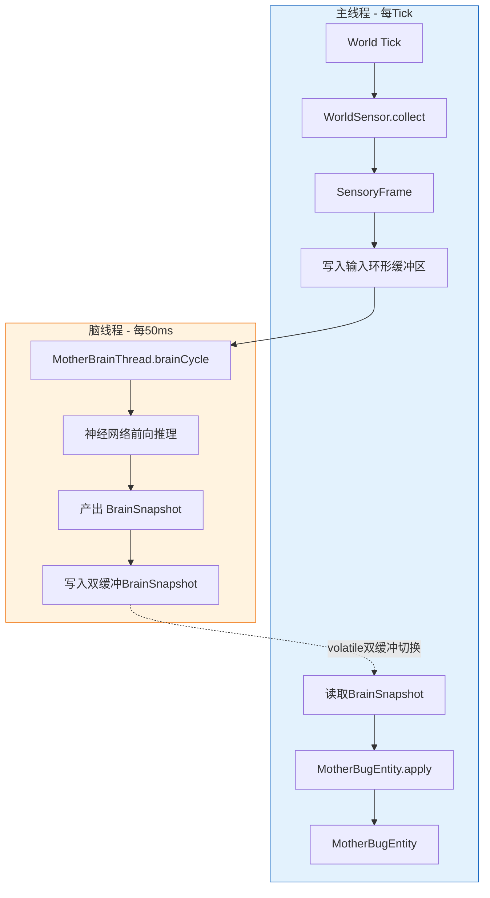

# 虫巢计划 - 架构设计文档

> 版本：Review-1.1  
> 适用阶段：第一阶段 - 搭神经管道，造会动的母虫  
> 参考实现：blendi-remade/fly-brain-minecraft  
> 更新：2026-11-26（修复 P0 线程安全问题）

---

## 1. 总体架构图



**ASCII 版本：**

```
┌─────────────────────────────────────────────────────────────────┐
│                    主线程 (Main Thread) - 每 Tick                │
│  ┌──────────┐   ┌────────────────┐   ┌──────────────┐           │
│  │ World    │──▶│ WorldSensor    │──▶│ 输入环形缓冲区  │           │
│  │ Tick     │   │ .collect()     │   │ (lock-free)  │           │
│  └──────────┘   └────────────────┘   └──────┬───────┘           │
│                                              │                   │
│  ┌────────────────┐   ┌──────────────┐      │                   │
│  │ MotherBugEntity│◀──│ BrainSnapshot │◀────┘                   │
│  │ .apply()       │   │ (volatile双缓冲)  │                       │
│  └────────────────┘   └──────────────┘                           │
└─────────────────────────────────────────────────────────────────┘
                               ▲
                               │ 每 50ms 唤醒
                               │
┌─────────────────────────────────────────────────────────────────┐
│                    脑线程 (Brain Thread) - 固定频率              │
│  ┌──────────────┐   ┌────────────────┐   ┌──────────────────┐  │
│  │ 读取输入缓冲  │──▶│ 神经网络前向推理 │──▶│ 产出 BrainSnapshot│  │
│  └──────────────┘   └────────────────┘   └────────┬─────────┘  │
│                                                    │             │
│                                          ┌─────────▼─────────┐  │
│                                          │ 写入BrainSnapshot │  │
│                                          │ (双缓冲原子切换)   │  │
│                                          └───────────────────┘  │
└─────────────────────────────────────────────────────────────────┘
```

---

## 2. 线程安全约束（核心规则）

### 2.1 Brain Thread Safety Rules

> **MotherBrainThread 不允许直接访问任何 Minecraft World/Entity 对象。**
> 所有神经推理必须基于 SensoryFrame 快照数据。

### 2.2 禁止访问的类

```java
// ❌ 脑线程禁止访问
World
ServerWorld
Entity
PathfinderMob
Chunk
BlockEntity
```

### 2.3 允许访问的类

```java
// ✅ 仅允许以下数据类型
SensoryFrame
MotorCommand
BrainSnapshot
Intent
```

### 2.4 Intent 禁止持有 Entity 引用

```java
// ❌ 错误设计
public final Entity targetEntity;

// ✅ 正确设计：使用 UUID
public final UUID targetEntityId;
```

查找方式由主线程执行：
```java
world.getEntity(uuid)
```

---

## 3. 五层职责说明

| 层级 | 名称 | 职责 | 核心类/接口 | 运行线程 |
|------|------|------|-------------|----------|
| **L1** | 世界接口层 | 从游戏世界采样状态，编码为标准化感官帧 | `WorldSensor`, `SensoryFrame` | 主线程 |
| **L2** | 母虫神经层 | 中央处理单元，接收感官帧，输出运动指令 | `MotherBrainThread`, `BrainSnapshot` | 独立后台线程 |
| **L3** | 意图提取层 | 将母虫原始输出解析为语义化高层意图 | `Intent`, `ExploreIntent`, `AttackIntent` | 脑线程内 |
| **L4** | 四子代理层 | 四个专项代理分工协作，将意图细化为群体指令 | `ScoutAgent`, `HarvesterAgent`, `WarriorAgent`, `BroodAgent` | 主线程/脑线程 |
| **L5** | 普通虫执行层 | 个体单元执行具体行为，汇报执行结果 | `CommonWormEntity`, `TaskExecutor` | 主线程 |

### 第一阶段最小实现范围（L1-L2-L3 核心闭环）
- ✅ **L1**：`SensoryFrame` + `WorldSensor`
- ✅ **L2**：`MotherBrainThread` + 双缓冲 `BrainSnapshot`
- ✅ **L3**：`Intent` sealed interface 体系
- ⏳ **L4/L5**：第二阶段实现

---

## 4. 核心数据结构

### 4.1 SensoryFrame（感官帧）

```java
public final class SensoryFrame {
    public final long worldSeed;
    public final int frameTick;
    public final float playerX, playerY, playerZ;
    public final float entityX, entityY, entityZ;
    public final int dimensionId;
    public final Presence nearbyEntityPresence;
    public final String nearbyEntityType;
    public final float nearestEntityDistance;
    public final boolean isDark;
    public final float daylight;
    public final int healthPercent;
    public final int ammoCount;
}
```

- **所有字段 final** - 不可变设计
- **无 setter** - 防止意外修改
- **生产者**：`WorldSensor.collect()` (主线程)
- **消费者**：`MotherBrainThread.brainCycle()` (脑线程)

### 4.2 BrainSnapshot（神经快照，双缓冲）

```java
public final class BrainSnapshot {
    public final long producingTick;
    public final boolean valid;
    public final float moveForward;      // -1..1
    public final float strafe;           // -1..1
    public final boolean jump;
    public final boolean attack;
    public final MotorAction action;
    public final float confidence;
    public final String debugReason;
}
```

- **所有字段 final** - 不可变设计
- **双缓冲机制**：`volatile BrainSnapshot head, tail`
- **工厂方法**：`BrainSnapshot.idle(tick)`, `BrainSnapshot.of(...)`

### 4.3 Intent（高层意图，sealed interface）

```java
public sealed interface Intent permits ExploreIntent, AttackIntent, GatherIntent, ReturnHomeIntent, IdleIntent {
    float priority();
    String type();
}

// 各实现类均使用 UUID 标识目标，不持有 Entity 引用
record ExploreIntent(UUID targetLocationId, float radius, long timestamp) implements Intent {}
record AttackIntent(UUID targetEntityId, float maxRange, long timestamp) implements Intent {}
record GatherIntent(UUID resourceId, int amount, long timestamp) implements Intent {}
record ReturnHomeIntent(long timestamp) implements Intent {}
record IdleIntent(long timestamp) implements Intent {}
```

### 4.4 MotorCommand（运动指令）

```java
public final class MotorCommand {
    public final float forward;
    public final float strafe;
    public final boolean jump;
    public final boolean attack;
    public final float confidence;
}
```

---

## 5. 线程调度方案

### 5.1 线程模型

| 线程 | 名称 | 调度方式 | 周期 | 核心职责 |
|------|------|----------|------|----------|
| 主线程 | `Server Thread` | Minecraft Tick 驱动 | 50ms (20 TPS) | 世界采样、实体更新 |
| 脑线程 | `MotherBrainThread` | `ScheduledExecutorService` | 50ms (20Hz) | 神经推理、快照生成 |

### 5.2 生命周期管理

```java
// ChongNaoJiHuaMod.java
public class ChongNaoJiHuaMod implements ModInitializer {
    private static volatile MotherBrainThread brain;
    private static volatile MotherBugEntity motherBugInstance;

    @Override
    public void onInitialize() {
        // 脑线程在模组初始化时启动（不依赖世界加载）
        brain = new MotherBrainThread();
        brain.startBrain();
        
        // 注册服务器生命周期事件
        ServerLifecycleEvents.SERVER_STARTING.register(s -> {
            server = s;
        });
        ServerLifecycleEvents.SERVER_STOPPING.register(s -> {
            brain.stopBrain();
        });
        
        // 注册 Tick 事件
        ServerTickEvents.END_WORLD_TICK.register(world -> {
            if (brain == null || !brain.isRunning()) return;
            if (motherBugInstance == null || !motherBugInstance.isAlive()) return;
            
            WorldSensor.collect(world, null, motherBugInstance);
            brain.feed(WorldSensor.peek());
        });
    }
    
    // 母虫生成时注册
    public static void registerMotherBug(MotherBugEntity bug) {
        motherBugInstance = bug;
    }
}
```

**注意**：当前实现为启动时固定创建脑线程。后续可扩展为：
- 母虫生成时启动脑线程
- 母虫死亡时关闭脑线程
- 由 `HiveController` 统一管理

---

## 6. 环形缓冲区与丢帧统计

### 6.1 SensoryFrameRingBuffer

```java
public class SensoryFrameRingBuffer {
    private final SensoryFrame[] buffer;
    private final AtomicInteger writeIndex;
    private final AtomicInteger readIndex;
    private final AtomicInteger count;
    private final AtomicInteger droppedFrames;  // 丢弃帧计数
    private final AtomicInteger totalFrames;     // 总帧数
    
    public float getDropRate() { ... }  // 丢帧率
    public void resetStats() { ... }     // 重置统计
}
```

### 6.2 调试命令

```
/brain status  - 显示脑线程状态、缓冲大小、丢帧率
/brain reset   - 重置丢帧统计
```

输出示例：
```
脑线程状态:
  运行: true
  Tick: 12345
  Action: IDLE
  Confidence: 0.50
  缓冲大小: 3/64
  丢帧率: 0.0%
```

---

## 7. 消息流时序

```
时间轴 (ms)          主线程 (20Hz)                    脑线程 (20Hz @ 50ms间隔)
────────────────────────────────────────────────────────────────────────────
0                    Tick N: WorldSensor.collect()    
                      写入 ringBuffer                  
                      读取 BrainSnapshot.current      
                      MotherBugEntity.apply()          
                      ──────────────────────────────────▶ (脑线程读取 ringBuffer)
16                   Tick N+1: 同上                   
32                   Tick N+2: 同上                   
50                                                                   唤醒
                                                          读取最新 SensoryFrame
                                                          神经网络前向推理
                                                          产出 BrainSnapshot
                                                          写入 BrainSnapshot.next
                                                          volatile 切换 current=next
                                                          休眠至下一个 50ms
```

---

## 8. 后续扩展接口 (预留)

### 8.1 L4 四子代理接口

```java
public sealed interface SubAgent permits ScoutAgent, HarvesterAgent, WarriorAgent, BroodAgent {
    GroupOrder process(Intent intent, SensoryFrame context);
    AgentType getType();
}

public enum AgentType { SCOUT, HARVESTER, WARRIOR, BROOD }
```

### 8.2 信息素系统接口（预留）

```java
public interface PheromoneField {
    void emit(UUID sourceId, PheromoneType type, float intensity);
    PheromoneReading sample(float x, float y, float z);
}

public enum PheromoneType {
    EXPLORE, BATTLE, RESOURCE, RETREAT
}
```

---

## 9. 文档维护

- **位置**：项目根目录 `ARCHITECTURE.md` 与 `src/main/resources/ARCHITECTURE.md` 同步
- **更新触发**：架构变更、新增层级、线程模型调整
- **审核**：Chief 审核，机仆1 确认可编译，大肥鱼 批准

---

*文档由 机仆2 整理，基于架构审查清单 Review-1 更新*
